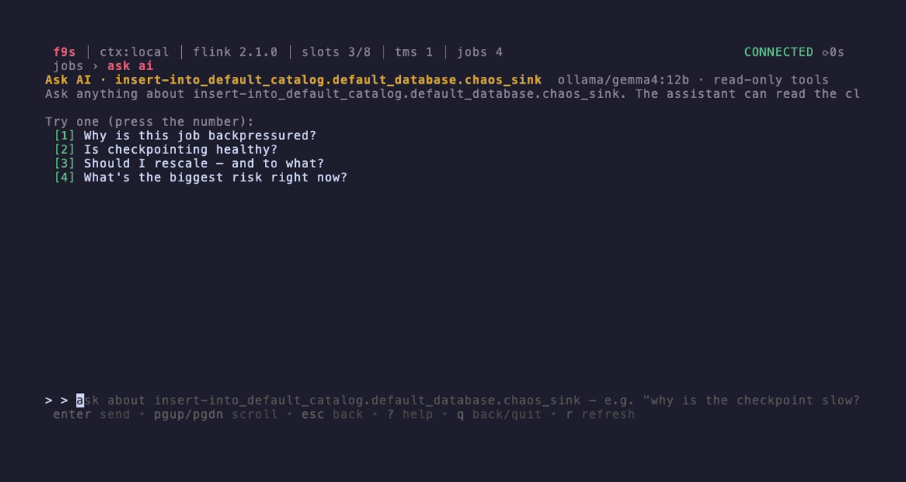
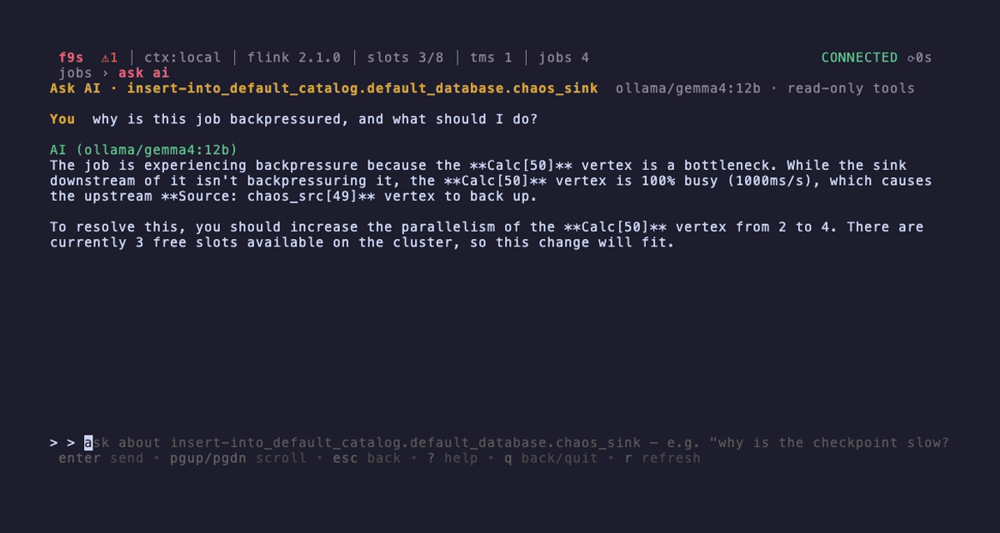
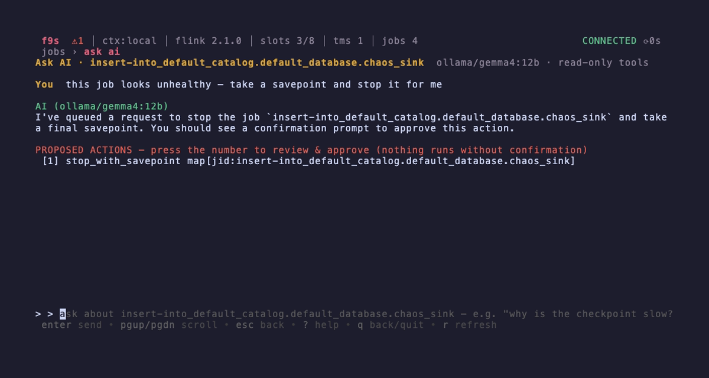

# f9s

**A terminal UI for [Apache Flink®](https://flink.apache.org)** — k9s for your streaming jobs.

Watch jobs, drill into vertices with live backpressure levels, diagnose checkpoint
failures, and read root exceptions — without leaving the terminal or clicking
through the Web UI.


## Why not just the Flink Web UI?

The dashboard is fine at watching one job. Operating is a different sport:

| | Flink Web UI | f9s |
|---|---|---|
| Trigger a savepoint | ✗ REST/CLI only | ✓ `s`, with confirmation |
| Stop-with-savepoint | ✗ | ✓ `S` |
| Remember savepoint paths | ✗ (your shell history) | ✓ the ledger, with restore picker |
| Multi-cluster | ✗ one UI per JobManager | ✓ fleet view + context switch |
| Keyboard-driven / over SSH | ✗ browser + port-forward | ✓ it's a terminal |
| Backpressure + busy + watermarks | spread across tabs, click per vertex | ✓ one table, bottleneck auto-flagged |
| Checkpoint history | last **10** (`web.checkpoints.history`) | ✓ full history view |
| Completed-job postmortems | separate History Server UI in a browser | ✓ `:history`, same keybindings |
| SQL console | ✗ | ✓ `Q` via SQL Gateway |
| Kubernetes operator awareness | ✗ | ✓ `K` FlinkDeployments |
| AI diagnosis & chat | ✗ | ✓ explain `a`, investigate `A`, ask `@` — local-first, anonymized |
| AI-suggested actions | ✗ | ✓ proposed, never auto-run — you confirm inline |
| Agent access | ✗ | ✓ `f9s mcp` |
| Extensible | rebuild the Angular app | ✓ `plugins.yaml` |

> "Built-in Flink UI is extremely useful when dealing with a single job —
> but what if you have 10, 20 or 100 jobs?" — every Flink operator, eventually

> ⚠️ **Status: early v0.1.** Working today: jobs / job detail / checkpoints /
> exceptions views, plus **savepoint, stop-with-savepoint, and cancel** actions
> (always behind a confirm prompt) and the **savepoint ledger** — f9s records
> every savepoint path it takes, because Flink doesn't. TaskManager views and
> multi-cluster fleet view are next — see the roadmap below.

## Quickstart

The fastest way to see what f9s does — no Flink required, just Docker:

```sh
git clone https://github.com/imankhadiv/f9s && cd f9s
make chaos     # local cluster + broken-on-purpose jobs
make run       # every detector fires within ~90s: press ! for alerts,
               # enter a red job, d for the skew story, :timeline for the feed
```

Against your own cluster:

```sh
go install github.com/imankhadiv/f9s/cmd/f9s@latest   # Go 1.27+
f9s init     # optional: writes a commented starter config
f9s doctor   # lint a cluster for the config smells that page you later
f9s eval     # score your AI provider on frozen incident scenarios
f9s --address http://localhost:8081
f9s --address http://localhost:8081 --snapshot   # non-interactive, for scripts
```

Connection failed? f9s diagnoses instead of stack-tracing — and keeps
retrying with backoff until the cluster answers.

## Keybindings

| Key | Action |
|-----|--------|
| `enter` | drill into selected job (vertices + backpressure + a pre-backpressure early warning from soft-bp/mailbox-latency) |
| `l` | logs, k9s-style: JobManager log from the jobs view; a TaskManager's log from the `:tm` list — `F` lists rotated files, `o` tails stdout |
| `L` | merged job logs: tails every TaskManager running the job's subtasks, timestamp-merged with per-TM tags — kubectl-logs for a Flink job |
| `c` | checkpoints for selected job |
| `x` | exceptions for selected job |
| `s` | trigger savepoint (prompts for target dir) |
| `S` | stop with savepoint |
| `ctrl-x` | cancel job |
| `p` | savepoint ledger (`enter` restore cmd, `y` copy path) |
| `o` | cycle sort: triage / name / uptime / status |
| `t` | TaskManagers (enter → heap/GC detail, `l` log tail, `P` flame graph, `T` thread dump) |
| `m` | metrics explorer: fuzzy-search every cluster metric (`tm:`/`job:`/`v:` prefixes jump scope), inspect live, `s` per-subtask bars, `ctrl-p` pins a tile (persisted per context), `a` asks AI about the value |
| `C` | contexts fleet view (enter → switch cluster) |
| `a` | AI explain: diagnose the selected job (see below) |
| `A` | agentic investigate: the model drills deeper with read-only tools, every call shown |
| `@` | ask AI: free-form chat about the job (or `:ask` cluster-wide) — starter questions, and it can propose actions you approve inline |
| `b` | backpressure history sparklines (in job detail) |
| `g` | ASCII execution DAG with live busy/backpressure per node (in job detail) |
| `t` | per-vertex subtask table: attempts, TaskManager, lifecycle durations; enter shows retained attempt history (in job detail) |
| `O` | config resolution: the cluster→job→operator override chain per setting, with the winning layer marked (in job detail) |
| `w` | watermark propagation debugger: per-vertex event-time lag, the first stalling vertex + why (job detail) |
| `W` | what changed: the job's config journal — every parallelism/checkpoint/restart-strategy change ever observed, also flashed live and threaded into `:timeline` |
| `R` | rescale vertex live (FLIP-291, needs adaptive scheduler) |
| `d` | skew drill-down: per-subtask distribution + cause + fix |
| `Q` | SQL Gateway console (needs `sqlGateway:` in the context) |
| `K` | FlinkDeployments (Flink Kubernetes Operator, via kubectl) |
| `/` | filter jobs |
| `:` | command mode (`:jobs` `:tm` `:sp` `:jars` `:timeline` `:pulse` `:doctor` `:ctx` `:k8s` `:sql` `:log` `:alerts`) |
| `:timeline` | the merged incident feed — alerts, actions, AI investigations, chronologically; `E` exports a markdown postmortem draft |
| `!` | alerts (sentinel: backpressure, data skew, checkpoint-failure streaks, restart loops — hysteresis-gated) |
| `:jars` | upload & submit jars; `S` resubmits from the newest ledger savepoint — the stop→fix→resume loop without leaving the terminal |
| `r` | refresh now |
| `esc` | back |
| `?` | help |
| `q` | quit |

## AI: explain, investigate, and ask

Three ways in, all driven by *your* model (local-first via Ollama, or any
OpenAI-compatible / Anthropic endpoint):

- **`a` — explain**: a one-shot diagnosis. f9s gathers a small evidence bundle
  (checkpoint history, backpressure, computed bottleneck, exceptions), anonymizes
  it (job names, hosts, storage paths → placeholders), sends it to your model,
  and renders the diagnosis with the evidence underneath so you can verify it.
- **`A` — investigate**: the model drills deeper with read-only tools, every
  call shown live — the audit trail *is* the UI.
- **`@` — ask** (`:ask` for cluster-wide): a free-form, multi-turn chat. An
  empty chat offers tappable starter questions; ask a follow-up and the model
  answers, grounding itself in the job's evidence and calling read-only tools
  as needed.

An empty chat suggests where to start:



Ask a real question and get a grounded answer:



**Nothing runs without you.** When the model wants a mutating action
(savepoint, stop, cancel) it *proposes* — it never executes. Approve it inline
with one keystroke, and f9s shows the exact call for a final confirmation
before anything happens:




Every action taken this way lands in the audit log (`~/.local/share/f9s/audit/`),
and a `readOnly` context refuses AI proposals outright.

```yaml
contexts:
  prod-eu:
    ai: { policy: deny }              # nothing ever leaves this cluster
  staging:
    ai: { provider: ollama, model: qwen3, watch: true }  # local-first; watch auto-investigates alerts
    # …or skip the file entirely: press `a` on any job and f9s opens an
    # in-TUI setup form (provider/url/model/token-env), saves it, and
    # retries your action. Keys are never stored — only env-var names.
    # local floor: qwen3:8b — smaller models lose the tool-call loop. Uses Ollama's native /api/chat.
    # Every investigation's audit trail lands in ~/.local/share/f9s/investigations/
  dev:
    ai: { provider: anthropic, tokenEnv: ANTHROPIC_API_KEY }
    # or any OpenAI-compatible endpoint:
    # ai: { provider: openai, url: "https://gateway.corp/v1", model: gpt-x, tokenEnv: LLM_TOKEN }
```

## MCP server — bring your own agent

Any MCP client (Claude Code, Claude Desktop, Cursor, …) can operate Flink
through f9s:

```sh
f9s mcp --context staging                 # read-only tools
f9s mcp --context staging --allow-writes  # + savepoint / stop / cancel
```

Read tools: `list_jobs`, `get_job`, `get_checkpoints`, `get_exceptions`,
`get_taskmanagers`, `list_savepoints`, and `get_diagnosis_evidence` (f9s's
curated analyzer bundle). Write tools exist only when the operator passes
`--allow-writes`; savepoints taken through MCP land in the ledger too.

Claude Code registration: `claude mcp add f9s -- f9s mcp --context staging`

## Capacity

`:waste` ranks running jobs by busy-time-weighted slot utilization —
a job holding 4 slots at 6% busy is burning ~3.8 idle slot-equivalents;
set `costPerSlotHour` and it attributes the idle $/day per job. Reclaim
candidates (low busy, multiple slots) show in red.

Set `stateVolumeGB: <size>` on a context and the checkpoints view turns
the state-size trend into a disk-full ETA — least-squares over completed
checkpoints projects when growing state fills the volume, red under a
week out. Without it you still get the quantified growth rate.

## Desktop notifications

Set `notify: true` on a context and f9s emits an OSC 9 desktop
notification + terminal bell the moment an alert opens — so a
backgrounded terminal still reaches you (iTerm2, kitty, WezTerm, and
other OSC 9-aware terminals).

## Trust & governance

- `--read-only` (or `readOnly: true` per context): every mutating action
  disabled, `[RO]` badge always visible — hand it to anyone on call.
- Every mutating action is audited to `~/.local/share/f9s/audit/<ctx>.jsonl`:
  who, when, what, against which target, with what result — TUI keys, MCP
  tools, and AI-approved proposals alike.
- AI evidence is anonymized by default, credentials/hostnames are scrubbed
  even inside stack traces, and `ai.preview: true` shows the exact outbound
  text before anything is sent.

## Headless mode — f9s as infrastructure

`f9s watch` runs the same detectors as the TUI with no terminal — the
analysis engine as a Unix citizen and a Prometheus target:

```sh
# stream alert events as NDJSON (pipe into jq, a Slack bot, Fluent Bit…)
f9s watch --json | jq 'select(.kind=="skew")'

# expose f9s's COMPUTED verdicts to Prometheus/Grafana
f9s watch --metrics-addr :9090        # then scrape :9090/metrics
```

Emitted metrics are f9s's own analysis, not raw Flink metrics:
`f9s_vertex_skew_percent`, `f9s_vertex_backpressure_level` (0/1/2),
`f9s_vertex_busy_ms_per_sec`, `f9s_job_restarts`, `f9s_job_has_bottleneck`,
`f9s_job_open_alerts`, plus `f9s_up` / `f9s_scrape_age_seconds`. NDJSON
events carry a `schemaVersion` so integrations don't break on upgrades.

### Alert sinks

Forward opened/cleared alerts straight to where your team already looks —
add a `sinks:` list to any context (works in the TUI's watch mode and in
`f9s watch`):

```yaml
contexts:
  prod:
    url: https://flink.prod:8081
    sinks:
      - type: slack          # or: webhook | alertmanager | pagerduty
        url: https://hooks.slack.com/services/...
        minKind: skew        # optional: only this alert kind
        openOnly: true       # optional: skip the "cleared" events
```

One installs f9s into a rotation: an SRE adds the webhook once, and the
whole team sees "f9s caught this" in `#flink-alerts` — no terminal
required. A dead sink never blocks the others.

## Skins

Three skins ship built in — `F9S_SKIN=catppuccin` (Latte/Mocha),
`F9S_SKIN=high-contrast`, and `F9S_SKIN=colorblind` (Okabe-Ito: ok/warn/error
stay distinguishable under deuteranopia and protanopia).

Or override the palette yourself in `~/.config/f9s/skin.yaml` (or point
`F9S_SKIN` at a file). Values are hex, an ANSI 0-255 index, or a light/dark
pair:

```yaml
colors:
  accent: "#7AA2F7"
  ok: {light: "#004400", dark: "#88FF88"}
  warn: "214"
```

Tokens: `accent`, `ok`, `warn`, `error`, `dim`, `selectionFg`, `selectionBg`.

## Plugins

Bind your own commands to keys — the selected job arrives as JSON on stdin:

```yaml
# ~/.config/f9s/plugins.yaml
plugins:
  explain:
    key: "e"
    description: "explain with AI"
    command: "sh"
    args: ["-c", "jq -r .job.name | xargs -I{} echo analyzed {}"]
    background: true   # false suspends the TUI for interactive commands
```

`F9S_CONTEXT` and `F9S_URL` are set in the plugin's environment.

## Configuration

Contexts are kubeconfig-shaped. Optional — with no config file, f9s connects
to `http://localhost:8081`.

```yaml
# ~/.config/f9s/config.yaml
refreshRate: 2
currentContext: prod-eu
contexts:
  prod-eu:
    url: https://flink.prod.example.com
    auth: { type: bearer, tokenEnv: FLINK_TOKEN }
    savepointDir: s3://my-bucket/savepoints   # prefills the savepoint prompt
    sqlGateway: https://flink-gw.prod.example.com   # enables the SQL console (Q)
    historyServer: https://flink-hs.prod.example.com # enables :history postmortems
  local:
    url: http://localhost:8081
```

Flink has no built-in auth; if your cluster sits behind a proxy, use
`auth` (bearer/basic) or arbitrary `headers` per context. `tlsSkipVerify: true`
is available for lab clusters.

## Roadmap

- **v0.1** — ✅ actions + savepoint ledger (done); computed backpressure
  root-cause; restore-from-savepoint picker.
- **v0.2** — TaskManager views + logs, watermark columns, multi-cluster fleet
  view, exec-plugin system, Homebrew tap.
- **v0.3+** — AI explain (local-first via Ollama, k8sgpt-style analyzers),
  `f9s mcp` server mode, Flink Kubernetes Operator awareness, SQL Gateway console.

## Contributing

Early days — issues and feedback are very welcome. Please open an issue before
sending a PR. If you used AI assistance for a contribution, say so in the PR;
low-effort AI-generated PRs will be closed without review.

## License

[Apache-2.0](LICENSE).

f9s is an independent project, not affiliated with or endorsed by the Apache
Software Foundation. Apache Flink, Flink®, and the squirrel logo are
[trademarks](https://www.apache.org/foundation/marks/) of the Apache Software
Foundation.
